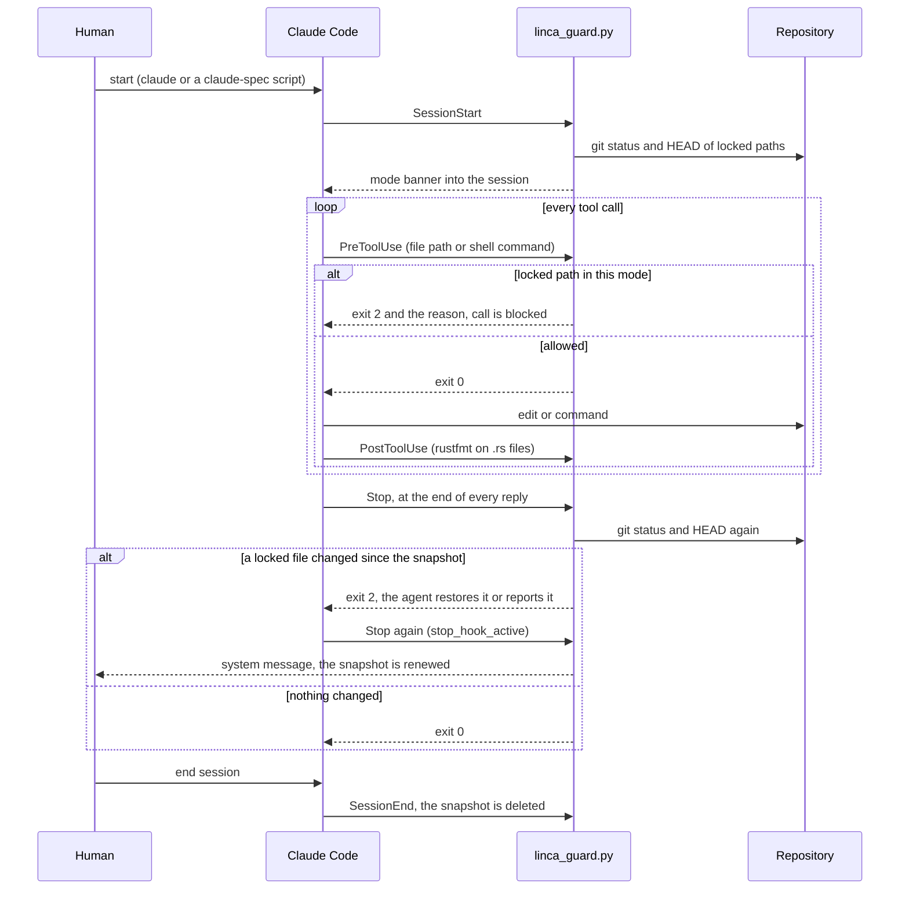

# The Linca agent harness

Everything in `.claude/` enforces [AI-POLICY.md](../AI-POLICY.md) for Claude Code sessions. The workflow it
supports is in [docs/AI Workflow.md](<../docs/AI Workflow.md>). This file is for whoever changes the harness.

Works on Windows (native, no WSL), Linux and macOS. Requires Python 3.9+, git and, on Windows, Git for Windows:
Claude Code runs hook commands with Git Bash there.

## Files

| Path | What it is |
|---|---|
| `settings.json` | permissions (allowed cargo and git commands; `git push`, `git commit` and destructive git rules) and the hook wiring |
| `hooks/guard.sh` | entry point of every hook; plain POSIX sh; finds a working Python and runs `linca_guard.py` |
| `hooks/linca_guard.py` | all hook logic, the same on every platform |
| `skills/implement-cases/` | `/implement-cases <filter>`: the impl loop; started by the human only |
| `skills/spec-change/` | `/spec-change <rule or ADR>`: spec, code table and cases together; started by the human only |
| `skills/adr/` | ADR drafts and the template; used by the agent on its own or as `/adr` |
| `skills/linca-spec/` | map of codes, spec sections, phases and IR keys; loaded by the agent when it needs it |
| `agents/reviewer.md` | subagent that reviews a diff it did not write |
| `.baseline/` | per-session snapshots written by the hooks; not in git |

The whole of `.claude/` is locked for agents in every mode. Edit it by hand.

## A session, from the hooks' side



## Hook events

| Event | What `linca_guard.py` does |
|---|---|
| `SessionStart` | reads `LINCA_MODE` (`impl` by default, or `spec`), prints the mode and what is locked, prunes snapshots older than 7 days, writes the session snapshot |
| `PreToolUse` | for Edit, Write, MultiEdit and NotebookEdit: blocks a locked path. For Bash and PowerShell: blocks a command that writes to a locked path, and `git stash`, `git clean`, `git reset --hard` |
| `PostToolUse` | runs rustfmt on an edited `.rs` file |
| `Stop` | compares locked files with the snapshot; once per change, sends the agent back, then tells the human and renews the snapshot |
| `SessionEnd` | deletes the session snapshot |

Exit code 2 blocks a tool call and shows the reason to the agent.

## What is locked

Defined at the top of `linca_guard.py`:

- `LOCKED["impl"]`: `docs/`, `schema/`, `tests/data/lang/`, `examples/`, `AGENTS.md`, `CLAUDE.md`, `.gitattributes`
- `LOCKED["spec"]`: `crates/`, `Cargo.toml`, `Cargo.lock`
- `HARNESS`, both modes: `.claude/`, `AI-POLICY.md`, `docs/ai-workflow.md`
- `DECISIONS`, both modes: `docs/decisions/`, except files matching `DRAFT_ADR`
  (`docs/decisions/NNNN-kebab-title.draft.md`)

## How shell commands are checked

Every path-like word in a command is normalised first: backslashes, the repository root written out
(`C:\...`, `/c/...`, `/home/...`), `./` and `..` segments, trailing slashes, and letter case on Windows. The
command is then blocked if a write verb, a redirect, `sed -i`, a tree-changing git command or a .NET file call
reaches:

- a locked path or anything inside it;
- a parent directory of one, named as a whole (`rm -rf tests`, `rm -rf tests/*`);
- the whole tree (`.`, `*`, `:/`).

## Snapshots

A snapshot holds `HEAD` and the hashes of the locked files that were already dirty at session start, which is
usually none. Git does the rest, so the size and the time do not grow with the number of test cases. `Stop` flags
a locked file that:

- was clean at start and differs from `HEAD` now;
- was dirty at start and changed again;
- changed in a commit made during the session (the tree can be clean while `HEAD` moved).

It cannot tell who made a change. When the human edits a locked file during a session, the agent is told to report
it and touch nothing.

## Known gaps

- The shell check reads the command as text. It does not know the working directory (`cd crates && rm -rf ../docs`
  passes) and cannot see writes made from inside a program (`python -c ...`). `Stop` catches these afterwards.
- It also blocks harmless commands that merely mention `git stash`, for example inside an `echo`.
- On Linux and macOS paths are case-sensitive, so `DOCS/` is not `docs/` there.
- Hooks that do not run block nothing, and Claude Code does not report it. Check the mode banner at session start.

## Changing the harness

1. Edit the files by hand. An agent cannot, in any mode.
2. Test the guard by feeding it hook input:

   ```sh
   echo '{"tool_name":"Edit","tool_input":{"file_path":"'"$PWD"'/docs/Specification.md"}}' \
     | CLAUDE_PROJECT_DIR="$PWD" sh .claude/hooks/guard.sh pre-tool; echo "exit $?"
   ```

   Exit 2 means blocked; the reason is on stderr.
3. Restart or resume the session: the next `SessionStart` takes a fresh snapshot.
4. Commit the harness change on its own.