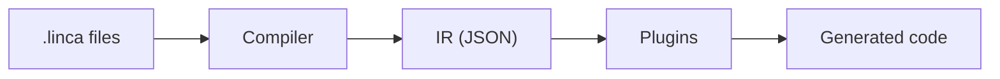

# Linca

Linca is a schema language for data models and service interfaces. You describe them once in `.linca` files; plugins generate ORM models, database schemas and API contracts for different languages.



```linca
model User {
  id: Uuid @primary @default(uuid())
  email: String @unique
}
```

## Repository

| Path | Contents |
|---|---|
| `docs/` | language specification, IR specification, compiler RFC |
| `schema/` | JSON Schema of the IR |
| `examples/shop/` | example schema and its IR |
| `tests/data/lang/` | language test cases |

Status: draft, version 0.1. There is no compiler yet.
