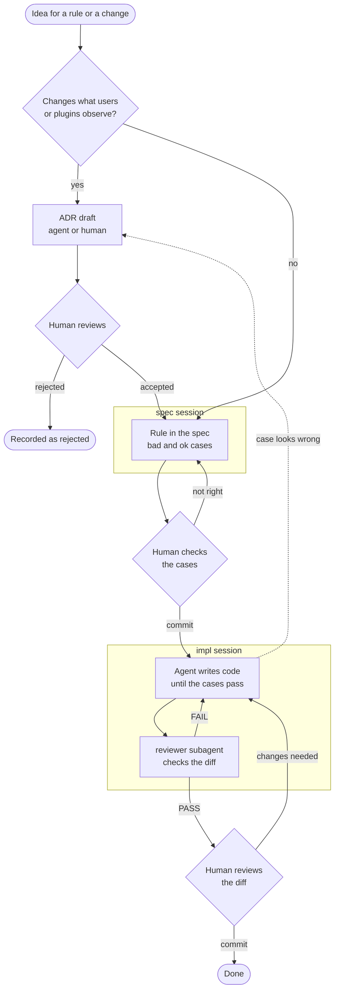
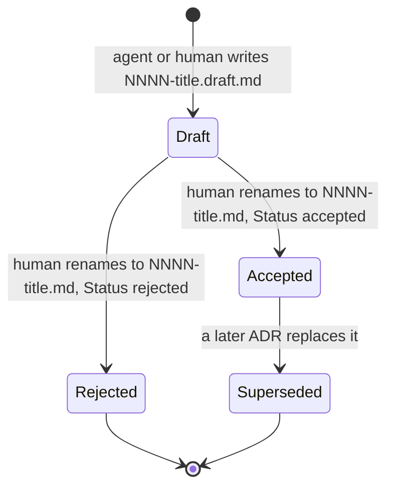

# AI workflow

How Linca is built with AI agents: the two kinds of session, how a rule becomes code, how decisions are recorded,
and the daily routine. The rules behind it are in [AI-POLICY.md](../AI-POLICY.md); how they are enforced is in
[.claude/README.md](../.claude/README.md). Instructions for the agent itself are in [AGENTS.md](../AGENTS.md).

## Sources of truth

1. **Conformance cases**, `tests/data/lang/`. The expected diagnostics are the `//~ CODE` annotations in the case
   files; the rules for matching them are in `tests/data/lang/README.md`.
2. **Specifications**: `docs/Specification.md` (language), `docs/IR Specification.md` and
   `schema/linca-ir.schema.json` (IR).
3. **Compiler RFC**, `docs/Compiler RFC.md`: architecture, phases, CLI.
4. **Decision records**, `docs/decisions/`: why a rule is the way it is.

The compiler is correct when it passes the cases. A disagreement between the compiler, a case and the spec is
settled by deciding which of the three is wrong, and that decision is a human's.

## Two kinds of session

| Mode | Start with (sh / Git Bash) | PowerShell | Nushell | The agent can change | Locked |
|---|---|---|---|---|---|
| impl | `claude` | `claude` | `claude` | `crates/`, ADR drafts | `docs/`, `schema/`, `tests/data/lang/`, `examples/`, `AGENTS.md`, `CLAUDE.md`, `.gitattributes` |
| spec | `scripts/claude-spec.sh` | `.\scripts\claude-spec.ps1` | `nu scripts/claude-spec.nu` | `docs/`, `schema/`, `tests/data/lang/`, `examples/`, `AGENTS.md`, ADR drafts | `crates/`, `Cargo.toml`, `Cargo.lock` |

Locked in both modes: `.claude/`, `AI-POLICY.md`, this file, and everything in `docs/decisions/` except ADR
drafts (`NNNN-title.draft.md`).

The spec scripts set `LINCA_MODE=spec` for that one run only, so a later plain `claude` is impl mode again. Do not
set `LINCA_MODE` by hand in an interactive shell: it stays set for the whole terminal. To resume a spec session,
pass the flag through the script: `.\scripts\claude-spec.ps1 --resume`.

**Check that the hooks run.** At the start of a session ask "which Linca mode is this?". If the agent does not
know, the hooks did not run, and nothing is blocked. On Windows this usually means Git Bash was not found.

## From an idea to code

1. **Decide.** If the change alters what users or plugins observe, it starts as an ADR. Anyone may draft one; only
   a human accepts it.
2. **Specify (spec session).** `/spec-change <rule or ADR-NNNN>`: the agent writes the rule into the spec and the
   smallest `bad.linca` that breaks it and `ok.linca` that keeps it. You check that the cases say what the
   language should do; each is a few lines.
3. **Implement (impl session).** `/implement-cases <filter>`, for example `/implement-cases E05`: the agent writes
   code until the selected cases pass, then the `reviewer` subagent, which sees only the diff, looks for stubs,
   special cases, non-determinism and spec violations.
4. **Review and commit.** You read the diff, run what you want to run, and commit after human approval.

If, during step 3, the agent thinks a case or the spec is wrong, it does not touch them. It writes an ADR draft,
leaves the case failing, and reports the task as blocked. The question goes back to step 1.

## Decision records

- The number is given when the draft is created and never changes. Refer to records as `ADR-NNNN`, not by path.
- Reviewing a draft:
  1. read it;
  2. `git mv docs/decisions/0007-x.draft.md docs/decisions/0007-x.md`;
  3. add `- **Status:** accepted` or `rejected` and write the Decision section;
  4. if accepted, apply it in a spec session (`/spec-change ADR-0007`);
  5. commit.
- A rejected record stays, so the same option is not proposed again.

## Three kinds of test

| Kind | Where | Who writes it | Who decides it is right |
|---|---|---|---|
| Conformance cases | `tests/data/lang/` | agent in a spec session, from your rule; or you | you |
| Unit and property tests | inside `crates/` | agent in an impl session | the reviewer and you, as part of the code |
| IR snapshots (milestone 3) | next to valid cases | generated by the compiler | you, when you accept them |

Conformance cases define the language. Unit tests only protect the implementation. Snapshots are never accepted by
an agent.

## Daily use

- One task per impl session; one rule or one ADR per spec session.
- One agent at a time. Read its report when it finishes, not while it works.
- After every real agent mistake, add one line to "Lessons" in `AGENTS.md`, or a check to the hooks. The
  instructions grow from mistakes, not in advance.
- Commit the agent's work yourself, after reading the diff. The agent cannot push, and `git commit` asks you first.
