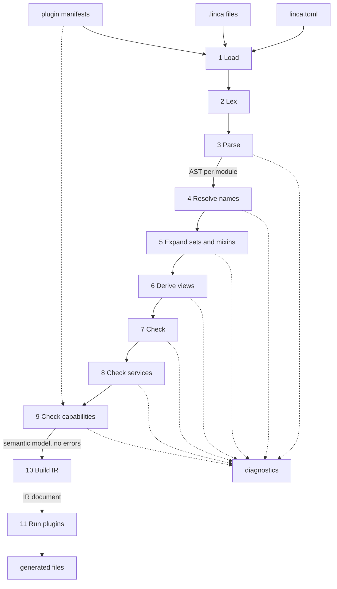

---

## title: Linca Compiler RFC version: 0.1 status: draft date: 2026-11-20 tags: [linca, rfc, compiler]

# Linca Compiler RFC

**Version:** 0.1 (draft) **Status:** for discussion **Scope:** the architecture of the reference compiler. The language is specified in [[Specification]], the output format in [[IR Specification]]. The plugin protocol is specified separately; this document only says where it plugs in.

---

## 1. Summary

The compiler is a batch program written in Rust. It reads a project configuration and a tree of `.linca` files, checks the schema as a whole, reports every problem it finds with a stable code, and, if there are no errors, builds one IR document and hands it to the configured plugins. Plugins return file contents; the compiler writes them.

It is built as a pipeline of eleven phases over two internal representations: a syntax tree per module, and one semantic model of the whole schema from which the IR is an almost direct serialization.

---

## 2. Goals and non-goals

Goals for v0.1:

1. **Correct.** Accept exactly the language of [[Specification]] and report exactly its diagnostics.
2. **Helpful when wrong.** Report all errors of a schema in one run, each with a code, a position and, where possible, a suggestion; in text for people and in JSON for tools and agents.
3. **Deterministic.** The same input gives the same diagnostics, the same IR and the same generated files, byte for byte.
4. **Small.** A single executable without a runtime; a code base one person can hold in their head.

Non-goals for v0.1, with the constraint each one puts on the design today:

|Not in v0.1|What must not be made impossible|
|---|---|
|Language server|the parser recovers from errors; every node has a position|
|Incremental compilation, watch mode|phases are pure functions of their inputs|
|`linca fmt`|the token stream, with comments, is kept next to the syntax tree|
|WASM or in-process plugins|the compiler talks to a plugin through one narrow interface|
|Performance tuning|nothing; see [[#12. Performance]]|

---

## 3. Decisions

|#|Question|Decision|
|---|---|---|
|1|Implementation language|Rust|
|2|Parser|hand-written recursive descent|
|3|Syntax tree|plain AST with positions; tokens kept alongside|
|4|Internal representations|two: AST and semantic model|
|5|Errors|collect all in one run; build the IR only without errors|
|6|Project configuration|a separate `linca.toml`|
|7|Who writes generated files|the compiler; a plugin returns contents|
|8|Code layout|three crates: IR types, compiler library, CLI|
|9|Tests|test case runner, IR snapshots, schema validation, "never panics" test|
|10|Determinism|no iteration over hash tables; stable order everywhere|

---

## 4. Architecture



Phases 2–3 work on one module at a time. Phases 4–10 work on the whole schema. A phase never modifies the output of an earlier phase; it reads it and produces new data.

### 4.1 Two representations

- **AST.** One tree per module, exactly what was written: imports, declarations, fields, operations, parameters, attribute uses, view operators, all with positions. Nothing is resolved.
- **Semantic model.** One structure for the schema: every declaration with an id, every name resolved, attribute sets and mixins expanded, views materialized, relations paired, the HTTP binding of every operation resolved, defaults of the language filled in. Its shape follows the IR, so phase 10 is a mapping without logic.

There is no third layer. If the semantic model and the IR drift apart, the difference belongs in phase 10 and nowhere else.

---

## 5. Phases

Each phase lists what it reads, what it produces and which diagnostics of [[Specification]] it reports.

### 5.1 Load

- Reads `linca.toml` ([[#7. Project configuration]]).
- Finds every `.linca` file under the schema root and derives its module path. Files are sorted by module path; nothing later depends on the order the file system returned them.
- Asks every configured plugin for its manifest: the backend kinds it implements, its capabilities and its attribute declarations. Manifests are needed before checking, because they declare namespaced attributes.
- A broken configuration or an unreadable file is a failure of the run, not a diagnostic of the schema ([[#8.3 Exit codes]]).

### 5.2 Lex

- Hand-written lexer. Produces tokens with byte offsets, including comment tokens.
- Reports E0101, E0102. An invalid character becomes an error token and lexing continues.
- Tokens include the arrow `->`. `service`, `error` and `throws` are keywords like the others.
- Keywords are lexed as keyword tokens regardless of context; the parser decides whether a keyword is a name ([[Specification#3.3 Keywords]]).

### 5.3 Parse

- Hand-written recursive descent with at most two tokens of lookahead.
- Produces an AST for the module, even when the module has syntax errors.
- Parses the declarations `service` and `error`. A service holds operations and an operation holds parameters; an operation starts with `@` or with a name followed by `(`, so two tokens of lookahead are enough ([[Specification#4. Grammar]]).
- Reports E0103–E0106, including E0104 for a keyword used as a name (ADR-0004). The name is marked poisoned.
- Recovery is described in [[#5.12 Error recovery]].

### 5.4 Resolve names

- Builds the table of declarations of every module (E0701, E0703), and the tables of operations of every service and of parameters of every operation (E0801, E0802).
- Processes imports (E0704, E0705, E0702).
- Resolves every type name, every name after `throws` and every attribute name to a declaration (E0201, E0401; W0401 for an attribute of a plugin that is not configured).
- Output: every reference in the schema points at a declaration id or is marked unresolved.

### 5.5 Expand

- Expands attribute sets into their attributes (E0410, then E0404 and E0402 on the result).
- Expands mixins into the declarations that use them, in order, each mixin once (E0601, E0602, E0603, E0304; E0303 for a record or an error that receives storage attributes).
- Every copied field records its origin.
- Checks the method attributes of operations and the paths in them (E0810, E0811), next to the other checks of repeated and malformed attribute uses. This is done here and not in the parser because a method attribute may come from an attribute set with target `operation`, so the method attributes of an operation can be counted only after expansion, as for E0404.

### 5.6 Derive views

- Orders views by dependency (E0612) and applies their operators left to right (E0610, E0613).
- Drops relation fields and storage attributes as the language defines.
- Runs the sensitive-field check, transitively (E0611).

### 5.7 Check

Everything that needs resolved and expanded declarations:

- types: E0204, E0205, E0210, E0211, E0212, E0220, E0221, E0222;
- declarations: E0301, E0302, E0310, E0311, E0312, E0320–E0323 (E0320 also for an error as a union member);
- attribute arguments and value generators: E0403 (also the range of `@status`), E0406 (also for the default of a parameter), E0407, E0408, E0409; W0405;
- relations: E0501–E0507;
- naming conventions: W0001.

### 5.8 Check services

Phase 8 is step 7 of [[Specification#11. Semantic checks (summary)]].

- Reads the resolved and expanded declarations, the types of parameters and results, and the sensitivity computed in phase 6.
- Checks the signatures: an error used as a type (E0803), a name after `throws` that is not an error (E0804), an error listed twice (E0805), a model in a signature (E0806), sensitive data in a result or in an error (E0807), an error with a field named `error` (E0808).
- Resolves the HTTP binding of every operation ([[Specification#17.5 HTTP binding]], [[Specification#17.6 Derived binding]]): the full path as segments, the method, the status, the placement of every parameter, the shape of the body, and whether the binding was derived. Reports placeholders without a parameter (E0812), parameters that cannot be placed where they are (E0813), two operations with the same method and path (E0814) and `@readonly` on an operation that changes state (E0815).
- The derived path uses the word splitting of [[IR Specification#4.1 Name]], the same function that phase 10 uses for `words`.
- Output: the binding and the `readonly` property are stored in the semantic model, so phase 10 only copies them.

### 5.9 Check capabilities

- Compares the capability-gated constructs used by the schema ([[Specification#16. Capability-gated constructs]]) with the capabilities of every configured plugin.
- Reports E0420, E0421, E0422 at the construct in the `.linca` file, naming the plugin.
- Skipped when no plugin is configured.

### 5.10 Build IR

- Runs only if there are no errors (warnings do not block).
- Maps the semantic model to the types of [[IR Specification]] and serializes them in canonical form.
- Maps `service` and `error` declarations to their nodes, with the resolved HTTP binding of every operation and the `category` of every error.
- Contains no decisions of its own.

### 5.11 Run plugins

- Starts every configured plugin as a child process, gives it the IR and its options, and reads back a list of files and, possibly, plugin diagnostics. The exchange format is the plugin protocol.
- Plugins run in parallel. Their results are applied in configuration order.
- Files are written only after **all** plugins have succeeded ([[#9. Generated files]]).

### 5.12 Error recovery

The aim is that one mistake produces one diagnostic and does not hide the next mistake.

**In the parser:**

- *Inside a block* the parser synchronizes on the next `field_name ":"`, on `@` after a completed field, and on `}`.
- *A declaration that starts inside a block.* Because keywords are contextual, `model` inside a block may be a field name. It is a field only if the next token is `:`. A declaration keyword followed by an identifier means the block was not closed: the parser reports the missing `}` once and continues with the new declaration.
- *Inside a service* the parser synchronizes on `@`, on a name followed by `(`, and on `}`. Parameters are synchronized on `,` and `)`.
- *At file level* the parser skips to the next token that can start a declaration: `import`, `@`, or a declaration keyword followed by an identifier.
- *In argument lists and brackets* it synchronizes on `,` and on the closing bracket.

**After parsing:** a node that is wrong is marked *poisoned*. Later phases skip poisoned nodes and anything that depends on them, instead of reporting consequences, warnings included. The poisoned node is the smallest item the error is reported on; a name with E0104 gets no W0001 (ADR-0004). An unknown type does not also produce a type mismatch; a field with a bad attribute is still expanded and checked for everything else.

**Limits.** At most 100 diagnostics are reported per run; the summary says how many were suppressed. Limit is configurable.

---

## 6. Diagnostics

### 6.1 Structure

|Part|Meaning|
|---|---|
|code|`E0304`, `W0001`; stable, from [[Specification#12. Diagnostics]]|
|severity|error or warning|
|message|one sentence about this occurrence|
|primary label|file and range the diagnostic points at, with a short text|
|secondary labels|other places that explain it (the first declaration of a duplicate, the mixin a field came from)|
|help|optional: what to do|
|fix|optional: a concrete edit, as a range and replacement text|

A code is defined once, in one table in the compiler: code, default severity, title. A test compares this table with the table in the language specification and with the language test cases, so the three cannot drift.

### 6.2 Order

Diagnostics are sorted by file path, then by position, then by code. The order does not depend on which phase found them.

### 6.3 Output

- **Text**, the default: written to stderr, with the source line and markers, for people.
- **JSON**, with `--format json`: one document on stdout. shape:

```json
{
  "diagnostics": [
    {
      "code": "E0304",
      "severity": "error",
      "message": "field `x` is declared twice in record `Point`",
      "file": "shop/geo.linca",
      "line": 4, "column": 3, "endLine": 4, "endColumn": 4,
      "secondary": [
        { "file": "shop/geo.linca", "line": 3, "column": 3, "endLine": 3, "endColumn": 4,
          "message": "first declared here" }
      ],
      "help": "rename one of the fields",
      "fix": null
    }
  ],
  "summary": { "errors": 1, "warnings": 0, "suppressed": 0 }
}
```

Lines and columns are 1-based; columns count characters, as in the IR. Keys are always present, as in the IR.

- `--deny-warnings` turns warnings into a failing exit code without changing how they are reported.

---

## 7. Project configuration

A project has one `linca.toml`. It holds everything that is about *this* project and not about the schema, so the same schema can be used by projects with different plugins.  contents:

```toml
[schema]
root = "schema"                 # directory with the .linca files

[[plugin]]
name = "prisma"                 # also the namespace of its attributes
command = "linca-gen-prisma"    # executable, or a list: ["python", "-m", "linca_pydantic"]
output = "prisma"               # directory its files are written to
migrations = true               # this plugin owns the database schema

[[plugin]]
name = "pydantic"
command = ["python", "-m", "linca_pydantic"]
output = "backend/app/models"

[plugin.options]                # passed to the plugin as is
module_layout = "per-module"
```

Rules:

- Paths are relative to the directory of `linca.toml`.
- Plugin names are unique.
- **One owner of migrations.** Among the plugins of the Storage kind, exactly one has `migrations = true`. The others generate mappings only. Zero or several owners is a configuration error. This is the decision that keeps two ORMs from each migrating the same database.
- Output directories of different plugins MUST NOT overlap.
- `options` is not interpreted by the compiler.

The compiler looks for `linca.toml` in the current directory and then in its parents; `--config` names it explicitly.

---

## 8. Command line

### 8.1 Commands

|Command|Does|Phases|
|---|---|---|
|`linca check`|checks the schema and reports diagnostics|1–9|
|`linca generate`|checks, builds the IR, runs the plugins, writes files|1–11|
|`linca generate --check`|as above, but writes nothing and fails if any file would change|1–11|
|`linca ir`|prints the IR|1–10|

`linca fmt` is reserved.

### 8.2 Options

|Option|Applies to|Meaning|
|---|---|---|
|`--config <path>`|all|use this `linca.toml`|
|`--format text\|json`|all|format of diagnostics|
|`--deny-warnings`|all|fail on warnings|
|`--only <id>`|`ir`|print one declaration and everything it refers to|
|`--compact`|`ir`|compact layout instead of pretty|
|`--plugin <name>`|`generate`|run only this plugin|

`linca ir --only` exists so an agent never has to load the IR of a whole project.

### 8.3 Exit codes

|Code|Meaning|
|---|---|
|0|success; warnings may have been reported|
|1|the schema has errors (or warnings with `--deny-warnings`)|
|2|wrong usage or broken configuration|
|3|a plugin failed|
|4|`generate --check` found files that would change|

---

## 9. Generated files

- A plugin never touches the disk. It returns paths relative to its output directory, and contents.
- The compiler rejects a path that is absolute or leaves the output directory.
- **All or nothing.** If any plugin fails, no file of any plugin is written.
- **Stale files.** The compiler records the files it wrote for each plugin in `.linca-generated.json` inside that plugin's output directory. On the next run, a file that is on the list and no longer returned is deleted. A file that is not on the list is never deleted or overwritten silently: overwriting a file the compiler did not write is an error.
- A file whose contents did not change is not rewritten, so build tools that watch timestamps stay quiet.
- `generate --check` performs the same comparison and reports the differences instead of writing.

---

## 10. Code layout

One Cargo workspace, three crates. names:

|Crate|Contents|Depends on|
|---|---|---|
|`linca-ir`|the Rust types of the IR, canonical serialization, deserialization|—|
|`linca-compiler`|everything in Sections 5–7 and 9, as a library|`linca-ir`|
|`linca`|the command-line program|`linca-compiler`|

`linca-ir` is separate because it is the one part a plugin written in Rust needs, and it is versioned with the IR, not with the compiler.

Modules of `linca-compiler`, one per concern:

|Module|Responsibility|
|---|---|
|`source`|files, module paths, offsets to line and column|
|`lexer`|tokens|
|`ast`|syntax tree types|
|`parser`|tokens to AST, recovery|
|`model`|semantic model types, ids|
|`resolve`|phase 4|
|`expand`|phase 5|
|`views`|phase 6|
|`check`|phase 7|
|`services`|phase 8|
|`caps`|phase 9|
|`lower`|phase 10|
|`diag`|codes, diagnostics, text and JSON rendering|
|`config`|`linca.toml`|
|`plugin`|manifests, running plugins, writing files|

The library does no input or output of its own except through `source`, `config` and `plugin`; the phases in between are functions from data to data and diagnostics.

**Data structures.** Declarations and fields live in vectors and are referred to by typed integer ids. Maps that are iterated keep insertion order. Positions inside the compiler are byte ranges; lines and columns are computed only when a diagnostic is rendered or a span is written to the IR.

**Dependencies.** Kept few: serialization (JSON, TOML), argument parsing, an insertion-ordered map, a diagnostic renderer, and test-only crates for snapshots, JSON Schema validation and property testing. Lexer and parser have none.

---

## 11. Testing

|Test|What it proves|
|---|---|
|**Test case runner**|every case of the language test cases behaves as annotated: each `//~ CODE` line gets that code, the set of codes matches, files without annotations are clean|
|**IR snapshots**|for every valid case, the IR equals the stored `<name>.ir.json`; a changed snapshot is reviewed, not regenerated blindly|
|**Schema validation**|every IR the compiler emits in tests validates against `schema/linca-ir.schema.json`|
|**Never panics**|arbitrary bytes and arbitrary token sequences make the compiler report diagnostics, not crash or hang|
|**Determinism**|compiling twice, and compiling with files discovered in a different order, gives identical bytes|
|**Code table**|the codes in the compiler, in the language specification and in the language test cases are the same set|
|**Plugin runner**|with a fake plugin: all-or-nothing writing, path rejection, stale-file removal, `--check`|

The language test cases are the main test. A disagreement between the compiler and a case is resolved by deciding which of the three is wrong: the compiler, the case or the specification.

---

## 12. Performance

Not a goal of v0.1, but there is a budget so that a regression is noticed.`linca check` on a schema of 1,000 declarations and 15,000 fields finishes in under 200 ms on a laptop. Nothing in the design is chosen for speed; if the budget is missed, measure first.

The time of `linca generate` is dominated by starting plugins, which is why they run in parallel.

---

## 13. Milestones

Each milestone ends with a part of the language test cases passing.

|#|Milestone|Done when|
|---|---|---|
|1|Lexer and parser|all cases with codes E01xx pass; every valid case parses without diagnostics; "never panics" test is green|
|2|Resolve, expand, views, check|the whole `diagnostics/` part of the language test cases passes, except the capability cases in `pending/`|
|3|IR|every valid case has a reviewed snapshot that validates against the schema; `linca ir` works|
|4|Plugins|`linca.toml`, manifests, plugin runner and file writing work with two reference generators; the `pending/` cases pass|
|5|Services|lexer, parser and resolution accept `service`, `error` and `throws`; phase 8 reports E0801–E0808 and E0810–E0815; every case that uses services passes; the IR has service and error nodes and every snapshot of these cases validates against the schema|

Milestone 2 is the largest. Milestones 1–3 need no plugin protocol; the protocol has to be written before milestone 4.

Services are the last milestone. The cases that use services belong to milestone 5 and are left out of milestones 1–4: everything under `valid/17_services/`, the project `projects/shop_example` with its `api.linca`, and every other case whose files use `service`, `error` or `throws`.

---

## 14. Open questions

1. **Lossless tree.** When `linca fmt` or a language server is started, the AST may have to be replaced by a tree that keeps whitespace. Keeping tokens alongside the AST is meant to postpone that, not to avoid it.
2. **Manifest calls.** Asking every plugin for its manifest on every run costs a process start each. Whether to cache manifests, and how to notice a changed plugin, is left to the plugin protocol.
3. **Stale files.** `.linca-generated.json` is one more generated file in the repository. The alternative is a header in every generated file, which the compiler cannot enforce for every file type.
4. **Plugin diagnostics.** Whether a plugin may report errors against positions in the `.linca` files, and whether such errors get codes, is for the plugin protocol.
5. **Windows.** Paths in the IR and in diagnostics use `/`. Whether `command` in `linca.toml` needs platform-specific forms is to be seen with the first plugin on Windows.
