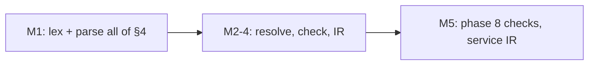

# ADR-0005. Parse `service`, `error` and `throws` in milestone 1

- **Proposed:** 2026-11-22, by TeseySTD
- **Affects:** compiler
- **Spec:** Specification §4, §17; Compiler RFC §5.2, §5.3, §13
- **Cases:** tests/data/lang/projects/shop_example, tests/data/lang/valid/17_services,
  tests/data/lang/diagnostics/E0104_keyword_as_operation_name
- **Status:** accepted

## Context

RFC §13 puts lexing and parsing of `service`, `error` and `throws` in milestone 5 and excludes every case
whose files use them from milestones 1–4. Milestone 1 is "all cases with codes E01xx pass; every valid case
parses without diagnostics". These conflict: E0104_keyword_as_operation_name is an E01xx case that uses
`service`, and `shop_example` (valid) has `api.linca`, so it cannot parse in milestone 1 or be a regression
check for milestones 2–4. Affected: the compiler plan, not users. Checks of §17 (E0801–E0815) are not in dispute.

## Options

### A. Keep as today (milestone 5)
Consequences:

Positive:
- Milestones 1–4 stay smaller; no service AST until needed.

Negative:
- The milestone-1 rule "all E01xx cases pass" is false for E0104_keyword_as_operation_name; it has to be
  listed as an exception.
- The grammar of §4 is implemented in two steps; the parser is reopened in milestone 5, and `shop_example`
  is untested until the end.

### B. Parse them in milestone 1; checks stay in milestone 5

Phases 4–7 skip service nodes (no tables, no checks) until milestone 5. Consequences:

Positive:
- Milestone 1 matches its text: every valid case, including `shop_example`, parses; E0104 on an operation passes.
- The parser is written once against the full grammar; E0103/E0106 cases for services can be added early.

Negative:
- Between milestones, service nodes are parsed and then ignored; the IR for services is absent, so `shop_example`
  can be excluded from snapshot and check tests, but not from "parses without diagnostics".
- E0104 on an operation needs the declaration tables of phase 4 for services, or is reported by the parser
  (RFC §5.3 gives it to resolve); this has to be decided in milestone 1.

## Decision
Option B. The parser covers the whole grammar of §4 in milestone 1, services included; E0104 on an operation is reported by the parser (ADR-0004). Phases 4–7 skip service and error declarations through one filter that milestone 5 removes. Cases that expect a diagnostic of §17 belong to milestone 5; until then the valid service cases only prove that they parse.

## Consequences

A: RFC §13 lists E0104_keyword_as_operation_name as an exception to milestone 1.
B: RFC §13 changes milestone 1 and 5 rows and the paragraph under the table: only checks and IR of services
move to 5, parsing does not. No change to the spec or the cases.
